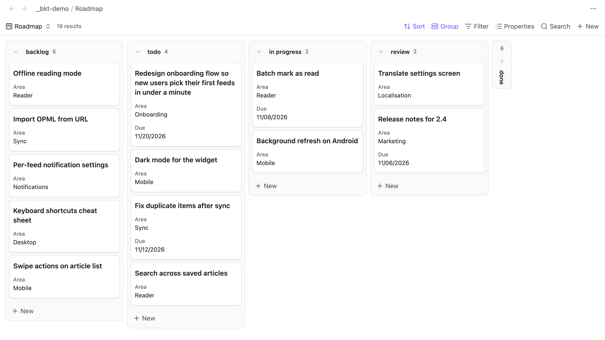

# Bases Kanban Toolbox

Improve native Bases Kanban boards with manual card order, compact cards, collapsible columns, a card popup and more.

It extends Obsidian's built-in Bases Kanban layout and does not add a separate view.



## Features

Every feature has its own switch in the settings, and changes apply to open boards right away.

### Compact cards

Each card is only as tall as the properties it actually shows, with the normal gap between cards. Long titles wrap onto as many lines as they need instead of being cut off, and the card grows to fit. Title heights are measured with the board's own font and column width. Scrolling, embedded Bases and drop markers follow the compact rows. Covers and other properties keep their space.

You can list properties under **Hide when empty**, for example `Reference, Due`. On a card where one of them has no value, it is hidden and the card gets shorter.

### Card popup

Clicking or tapping a card opens its note in a popup over the board instead of replacing the board in its tab. The popup shows the note's title, its editable properties and the live editor. Your edits save as usual, and any pending change is written when the popup closes. **Open note** opens it in the board's tab like the native click, and Back returns you to the board. Links inside a card and Cmd/Ctrl/Shift/Alt-clicks keep Obsidian's behaviour.

### Move to column

Right-click a card, or on mobile press and hold it and release without moving, and choose **Move to column** to send it to any other column, collapsed ones included. The move goes through Obsidian's own Kanban move, so it updates the grouping property (or moves the file when the board groups by folder) exactly like dragging the card across. Read-only boards and cards that can't be moved get no item.

### Fitted columns

Each column ends just below its last card instead of filling the whole board height, and scrolls once it reaches the bottom. While you drag a card, every column fills the board again, so a short or empty column is still an easy drop target.

### Collapsible columns

Each column header gets a chevron. Click it to collapse the column into a narrow strip showing its name and card count, and click the strip to expand it again. Collapsed state is saved per Base file and view in the plugin's data, not in the `.base` file, and follows Base renames. You can still drop cards onto a collapsed column.

### Manual card order

Drag a card up or down within a column, and the column's order is saved in a number property on each note, `Position` by default. The column is numbered 1..N in the order you made. Notes without the property get one on the next drop, and the **Undo last card reorder** command restores the previous values if the cards haven't been edited since.

The first time you reorder a card on a board that isn't sorted by the order property, the plugin numbers the column and then sorts the board by that property, ascending. This changes the sort saved in the board's `.base` file. Other columns follow their existing values until you reorder them. Undo restores the values, not the sort. Turn off **Sort boards automatically** if you'd rather set the sort yourself: then ordering only works on boards whose first sort is the order property, ascending.

Ordering isn't available on a board with a search or a result limit, or in a column with more than 500 cards: drops there keep Obsidian's behaviour. When a card's order value isn't a number or its grouping value is a list, a drop leaves the order unchanged and a notice says why. Moves between columns keep Obsidian's behaviour.

### Scroll position

Open a card in the board's tab and go Back, and you return to the same horizontal position and to each column's vertical position. Switching away from the board's tab and back keeps them too. Nothing is written to disk.

## Settings

| Group | Setting | Default |
|---|---|---|
| Cards | Compact cards | On |
| Cards | Hide when empty | Empty |
| Cards | Card popup | On |
| Cards | Move to column | On |
| Columns | Fit columns to cards | On |
| Columns | Collapsible columns | On |
| Card order | Manual card order | On |
| Card order | Order property | `Position` |
| Card order | Sort boards automatically | On |
| Navigation | Restore scroll position | On |

The settings show up in Obsidian's settings search. Changing compact cards, fit columns to cards, collapsible columns or restore scroll position resets the remembered scroll positions on open boards.

## Requirements

Obsidian 1.14.0 or newer, on desktop and mobile. The plugin hooks into Kanban internals and checks them first. If a future Obsidian release changes those internals, the affected feature falls back to native behaviour.

## Installation

From Community plugins in Obsidian, once the plugin is listed there.

Manually: download `main.js`, `manifest.json` and `styles.css` from the [latest release](https://github.com/prof18/bases-kanban-toolbox/releases/latest) into `<vault>/.obsidian/plugins/bases-kanban-toolbox/`, then enable the plugin under Community plugins.

## Privacy

No network requests and no background note scans. Notes and files are written only by actions you take. Reordering writes the order property, and with automatic sorting also the board's sort in its `.base` file. Move to column uses Obsidian's own move, which changes the grouping property or moves the file. Edits in the card popup save to the note like any editor.

## Development

```bash
npm install
npm run dev        # watch build to main.js
npm run check      # lint, tests, build
OBSIDIAN_VAULT=/path/to/vault npm run install:vault
```

To release, run `npm version <x.y.z>`, then push the tag. The release workflow attaches `main.js`, `manifest.json` and `styles.css`.

## Credits

The guarded drag adapter and rollback approach are adapted from [Bases Kanban Companion](https://github.com/jeonnewjin/bases-kanban-companion), copyright 2026 wjsyuwls, MIT.

## License

MIT, see [LICENSE](LICENSE).
